# Brawl Stars is getting problematic
31 October 2026

[tag]: game, brawl-stars

Most of you who know me in real life should know I play Brawl Stars for as long as you can remember, give or take during their global launch, which was almost 8 years ago. But those still playing game at the moment will see that I haven't logged in for at least the past one month.

Yes, I have found this game to be rather problematic and I think I can't let this concern remain bottled rage. Allow me to list several problems that finally pushed me for a long break, or at least indefinitely for now.

## Game balance

Supercell has always had apparent problems when it comes to balancing the interactions between all the brawlers in the game, especially when a new brawler comes.

### Hypercharges and buffies

<figure style="text-align: center;">
    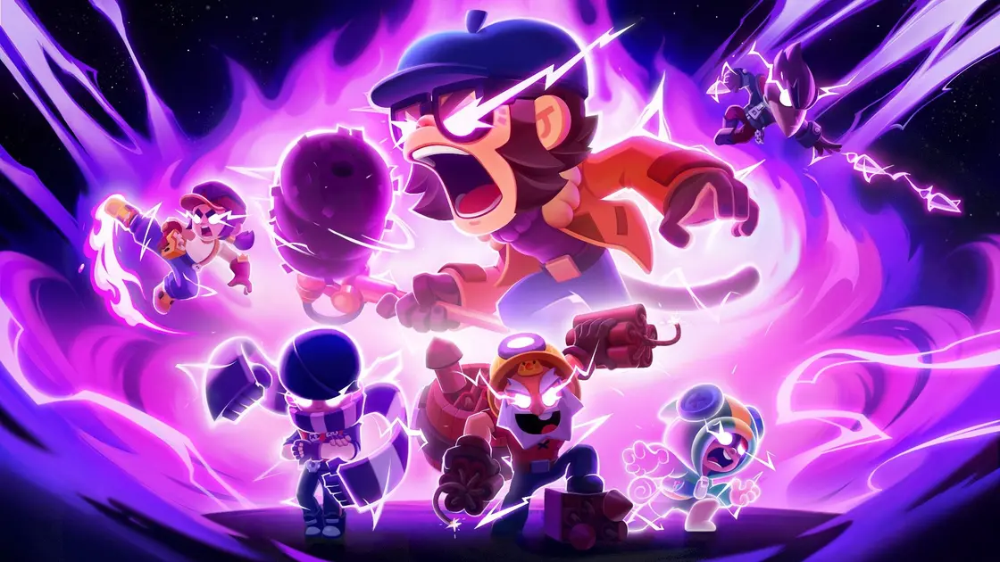
</figure>

This is probably the least of my concern, but I'm saying this in the view of someone who had all their brawlers maxed out, including having all existing hypercharges and buffies. That being said, the existence of hypercharges and buffies just shows how most brawlers mechanics that were great and innovative back in the days are utterly useless due to the buffies nullifying it.

Even when Supercell finally closes the gap and no more brawlers with no buffies, it shows that hypercharges and buffies dictate the course of the game: you don't have it, you lose the game (most of the time), and it's just gambling your risk all over again.

### Wendy

<figure style="text-align: center;">
    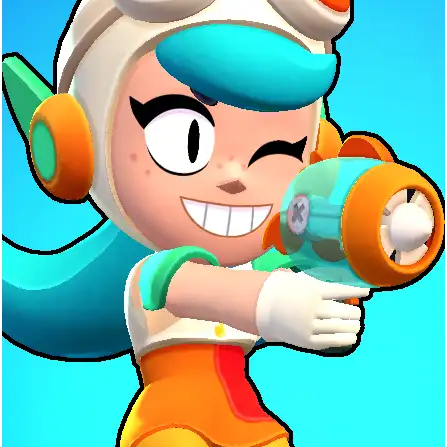
</figure>

Yes, Wendy (as well as Cosmo, Vince, and the list goes on). Bolt and Nori were a thing, but not enough to make me cross my tipping point and leave the game for a long time.

I don't know what Supercell devs were thinking when releasing her. Not the mention the COMMON pattern where they will always release a new brawler that's definitely broken so that every people would be annoyed to play against that new brawler and then ends up doing everything to obtain one, to the heights of paying its early access (exclude content creators, they are doing that to showcase content, which I feel they won't do on a personal basis).

It disgusts me on how people are still falling for this. Open your eyes and realize it's all dirty marketing, whether legal or not.

## Bugs and bugs

You may think Mortis going through walls is a once-in-a-blue-moon bug, but now we see the game openly introducing new bugs to the game, for whatever reason.

Certainly, whenever I lag, it's no longer always due to the telco. It's definitely the issues coming from the game server itself: something I could control less.

<figure style="text-align: center;">
    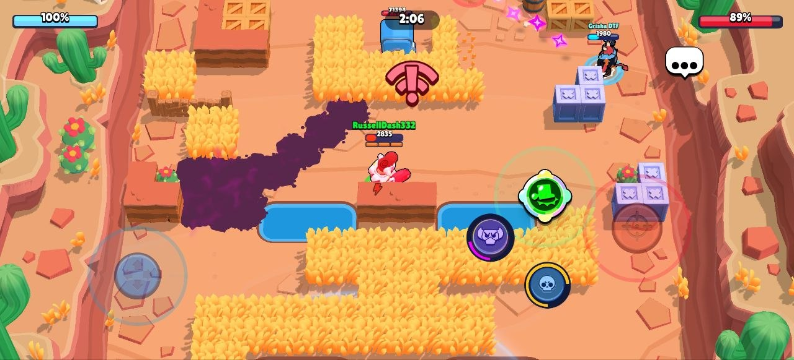
</figure>

Or maybe the well-known bug where you're stuck in the loading screen? This also boggles me on why can't they fix it as this is the first thing players will see upon entering the game? Do you only test on specific subset on devices? Do you only test when they are three players entering the server? Did you not stress test them? My QA soul screamed as I saw this happened on my own phone.

<figure style="text-align: center;">
    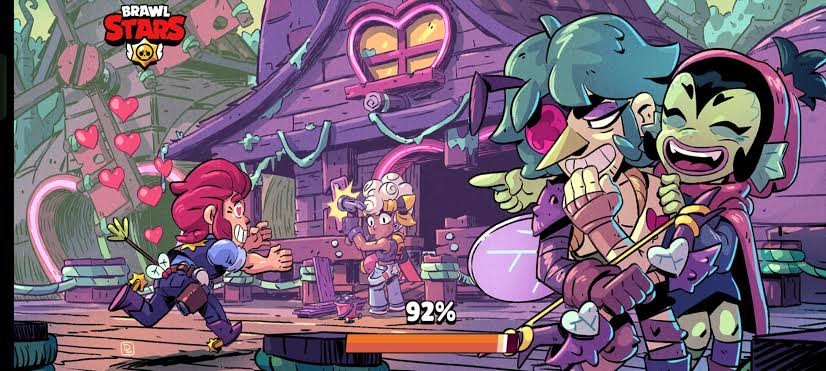
</figure>

And this is just the two most common bugs. There is a plethora of them in [this subreddit](https://www.reddit.com/r/10dollarproblem), showing how poor their QA unfortunately is.

## New players over retention

It's clear that the game cares new players coming and trying out the game rather than anything the old (and most likely loyal) players concerns about the game itself, causing people like me to finally lose retention.

### Apples and oranges

If you played Brawl Stars around the end of 2022, you might have been part of this big change of the game: **the rework of the damned trophy road**.

<figure style="text-align: center;">
    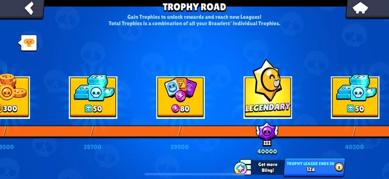
</figure>

In summary, whenever you cross a certain amount of trophies, you will obtain some rewards. Due to that rework, some of these rewards were replaced with higher-valued rewards, such as the conversion of 80 credits to a legendary Starr drop, which can be potentially an even higher value margin. However, every players who claimed the old rewards in the past will not be able to claim those new rewards.

The game claimed that it doesn't make sense to let people claim the trophy road rewards twice because the overall rewards weren't changed significantly, thus the "apples to oranges" meme that has been circling around for years because this is such a blatant case of logical fallacy that dismisses legitimate concerns about progression nerfs.

For me, this is the first time I felt cheated on as a loyal player of the game. At least I got Chester and Mandy (which became my favourite for the entirety of 2023-2025) during that controversial update. Cheers to the new players, I guess!

### Records 

<figure style="text-align: center;">
    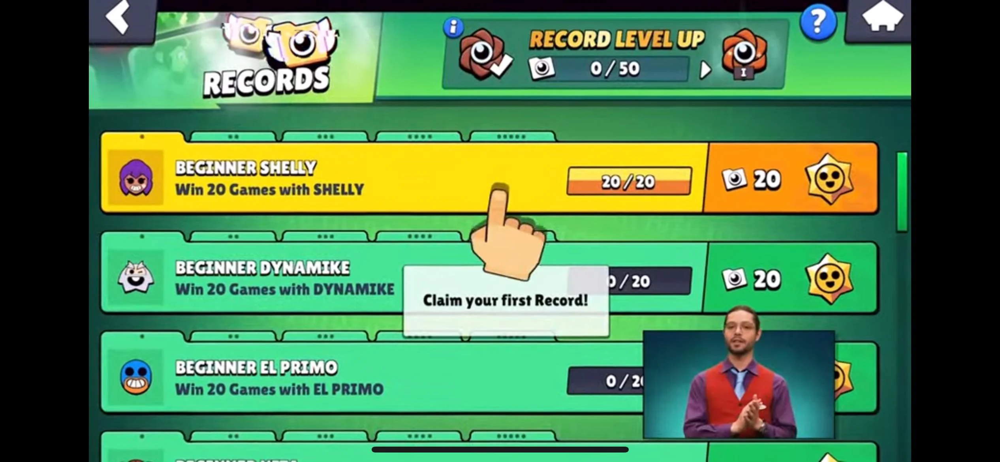
</figure>

Records is probably a good way to organize and keep track of your game activites and achievements, but the way this transition works is so controversial. I'll let Google AI search do this part for me, as I was in loss of words going through this part.

- **Replacement of Masteries**: Records replaced Masteries, which previously let players grind specific brawlers for guaranteed rewards like fixed gold, Power Points, and credits.
- **RNG-Based Rewards**: Instead of guaranteed resources, the Records system largely rewards players with random Starr Drops (including frequently criticized rare Starr Drops), turning progression into a gamble.
- **Removal of Credit Banking**: The system was partly designed to stop credit hoarding, but players argue it made unlocking new brawlers much harder and less transparent.
- **High Effort vs Low Payoff**: Completing hundreds of brawler and account records requires massive time investment for what many consider a severe nerf to the in-game economy.

Nevermind, the AI missed one thing: **the autocollect feature**!

Yes, some if not most of the players are purposely banking the rewards they obtained because they feel claiming them instantly would be a waste, e.g. credits are clearly better allocated for new brawlers rather than just the Fame system. The game devs knew we were banking good stuff and thought that's bad for... the game? themselves? I don't know! Politics!

## Ranked

The purpose is to serve the competitive side of the playerbase, but has become such an unhealthy if not the unhealthiest part of the game.

### Kids and the dark system

<figure style="text-align: center;">
    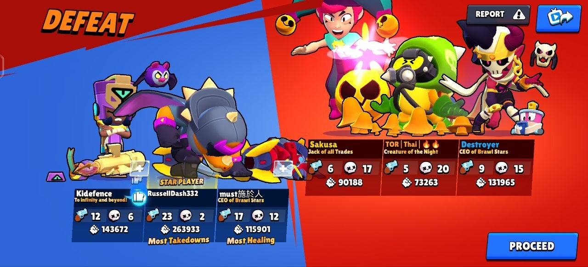
    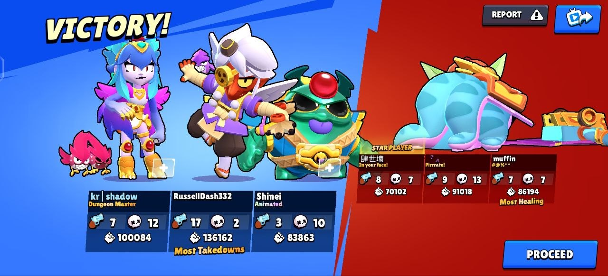
    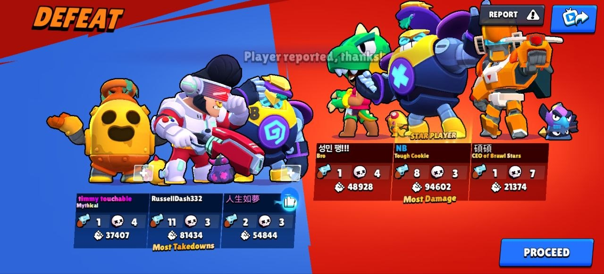
    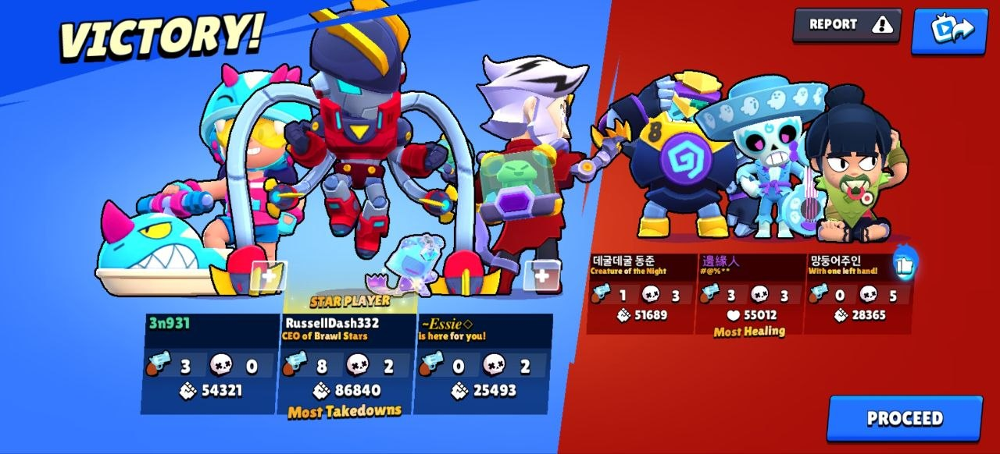
</figure>

The dark system is one thing, and I'm okay with this part as most MOBA games also have these too. But the fact that even on the big leagues, you still get kids that in WHATEVER objective of the game mode is (be it Bounty to kill more, or Brawl Ball to score more), you either sold the game or you die more than you kill. The lack of skill these teammates I get matched with consistently have shows that the mode wants me to lose trophies and time, like a lot of them.

Solo queue is literally almost impossible in ranked. Even when the game claims you get matched with people on the same league, usually it's the sore losers of the same league that you get matched up with. So **never** report them for bad random, report them for grief playing instead if you want some direct comeuppance on these players!

Don't give me the excuse that people make mistakes? Most of these people when confronted will conflate their ego saying that we aren't any better. That was NEVER the point of the conversation: saying sorry was all it took, because our precious two hours of grinding were wasted over a single loss.

One upside of this soulsucking game mode is that I get to play brawlers not as their class designation. From the screenshots above, it shows that the bad performance my teammates gave forced me to play Bull, a tank, like an assassin, making me go 11-2 in either brawl ball or heist (I forgot). Same thing for Angelo and Pierce, both marksmen, but I have to play like an assassin, killing enemies at closer range.

### Wintraders and aimbots

Now that I've been watching SZGusta's videos (since he plays a lot of ranked), I am even more convinced grinding ranked was just THAT unhealthy. We have wintraders to make the game even more pathetic, and the devs aren't really doing anything about this: they either completely ignore this issue, or has taken too much time on resolving the problem.

<figure style="text-align: center;">
    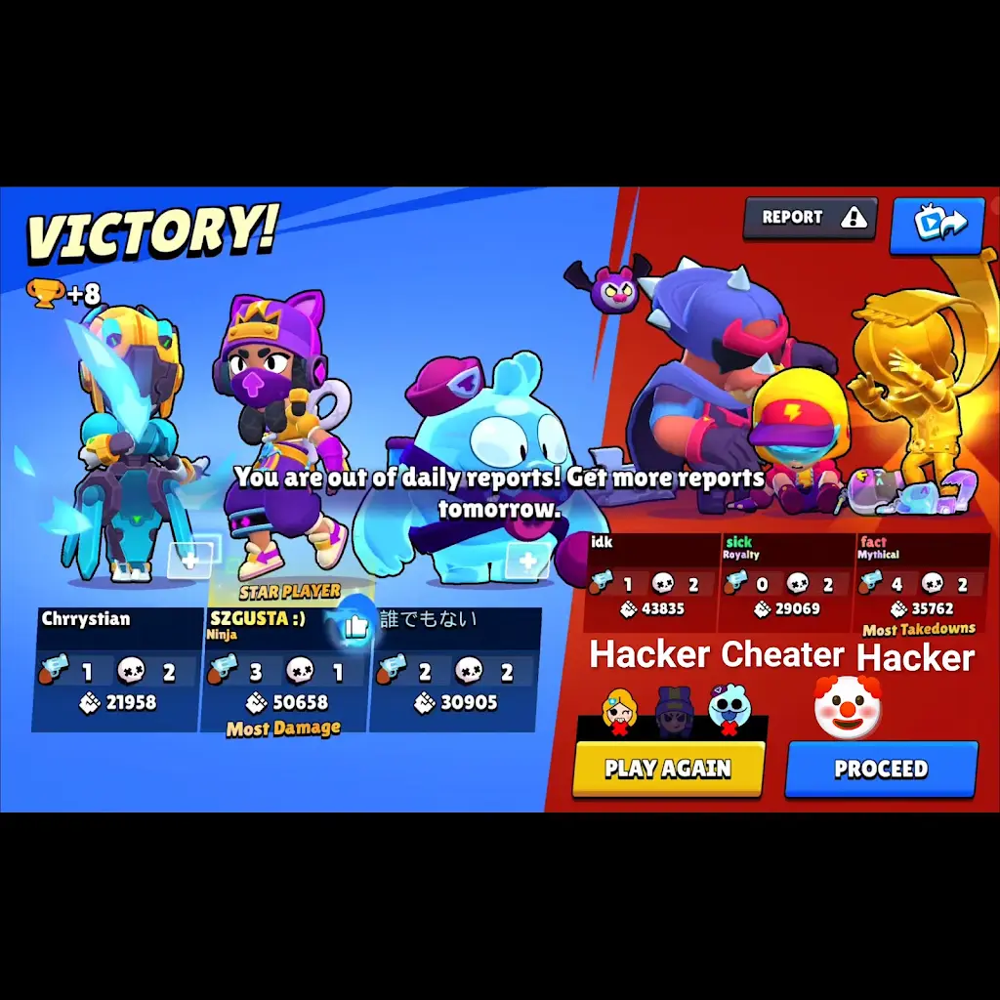
    <figcaption><i>Source: SZGUSTA TWO on Youtube</i></figcaption>
</figure>

How low can a human go to cheat and hack on a kids (or is it kids? they have been doing things not really kids-friendly anyways) game?

## Matchmaking

### MMR is failing

<figure style="text-align: center;">
    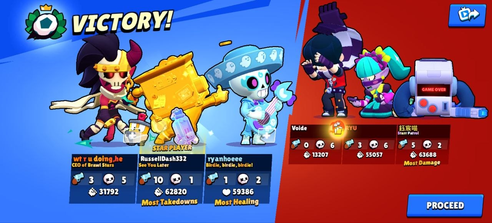
    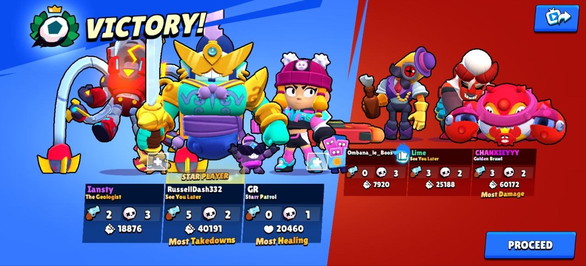
</figure>

The screenshots I presented were particularly for challenges, but the main question is: How accurate the matchmaking rating (MMR) is on determining the actual matchmaking?

I have found several threads on Reddit, such as [this one](https://www.reddit.com/r/Brawlstars/comments/1wqej7g/mmr_is_the_worst_thing_ever_added/) that claims otherwise. Another claims that the game is using records wins to determine your opponents instead, and since map maker is (somehow!?) counted as a win, then the more you play map maker with your lower-trophy brawlers, the more quickly you get tough opponents once you actually play ladder.

As for the event challenges itself, I feel such system isn't being applied at all. No matter how high my trophy is, both overall and the specific brawler I'm playing with, I always get teammates with an insanely low trophy, suggesting that MAYBE I am matched against people to even out the team trophy average rather than to find those with similar trophy count, which is stupid and incredibly punishing for most people at the end of the game's progression.

The only way to overcome this is to actually have a FULL team of people that you know instead of randumbs, and therefore the issue is only whether the opponent becomes stronger since you are now a full team in a queue instead of a solo queue. And no, being 2+1 doesn't help: the third random teammate can be even worse than you think!

To add on, the pity system and the underdog system didn't do much either. Overall, the MMR system, whatever update the game is introducing to fix the issue, is just adding salt to the deep wounds. Tough.

### The prestige system

<figure style="text-align: center;">
    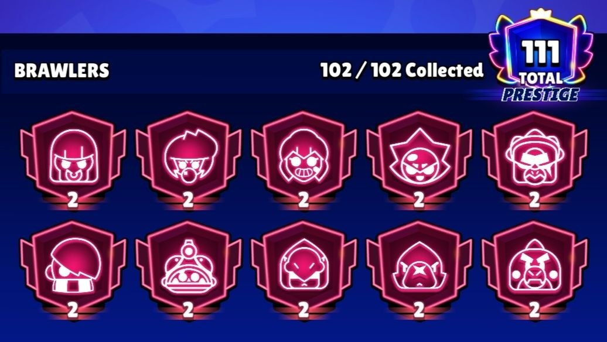
</figure>

I used to spend most of my time grinding ladder because it's easier to gain trophies than ranked Elo ratings, but with the prestige rework, this is both good and bad news for me.

**The good news**: More cosmetics, more rewards, something to flex on, more room for progression instead of being stuck at endgame!

**The bad news**: People will do anything even wintrading to be at the top. We have seen this even before the prestige system came to be and yet this is not fully fixed. There is also no more reset system, so now the sky's the limit, you'll see an incredibly inflated trophy leaderboard just because of this one thing. Not that the inflation is bad, but seeing an instant spike of it at once IS BAD. They introduce the no-reset system and yet the actual matchmaking system becomes worse as explained above. Get what I mean when it comes to priority management?

## The good stuff

It's not the end of the world! If you really need me to say something good about the game, of course I do.

Their latest collaboration with several brands are actually signs that the game still have some hope to continue living, and that, I'm happy about it!

<figure style="text-align: center;">
    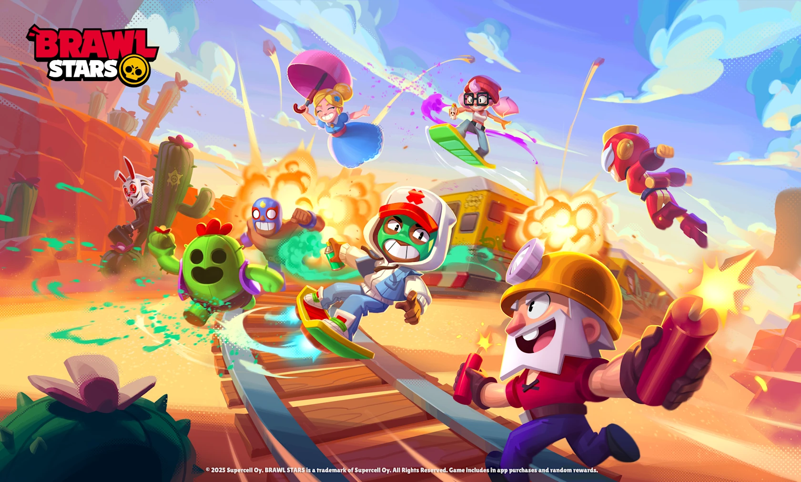
    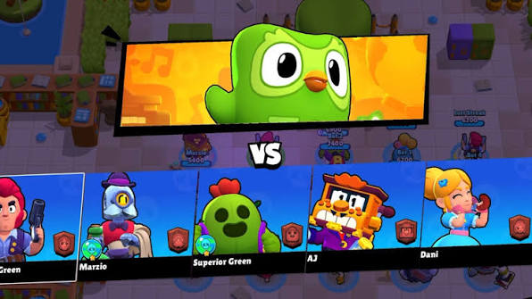
    <figcaption><i>Latest collabs I could think of: Subway Surfers and Duolingo</i></figcaption>
</figure>

The new skins are actually well-animated too, though I probably won't buy most of them because I wanted to keep the old good ones that I paid/earned painstakingly.

But then again, this write-up is more about what the game should be focusing on instead of just new brawlers (that are completely broken on purpose), or new this, or new that. There are some important homeworks to deal with or else!

## Epilogue

<figure style="text-align: center;">
    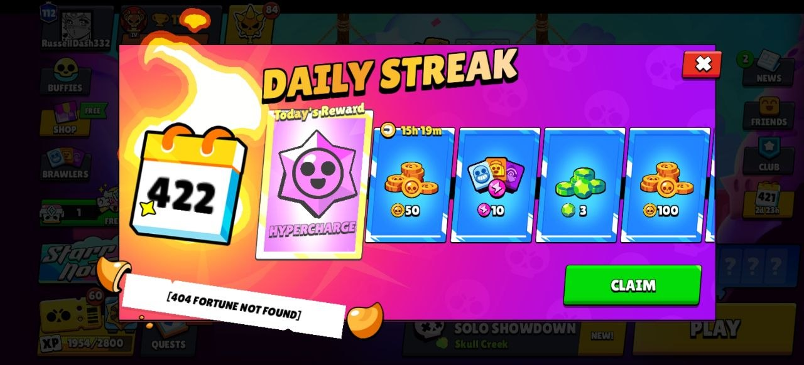
    <figcaption><i>probably the last relic I have of the game before I go</i></figcaption>
</figure>

No, I'm not saying that Brawl Stars fate is sealed.

As much as I've been enjoying myself and spending some money on the game, I know the game has a lot of improvements that I feel are crucial to the game, because it's gonna be much worse if whatever I said kept going on and on. Heck, I'm still playing Clash of Clans, a Supercell game, except I feel the overall aspects of the game and the concerns going around were well-addressed for (kudos to the devs there)!

I also admit that I'm not the best at the game, but having played for so long, I should've seen enough things in the game for me to say a lot on. If you have differing opinions or more of it that I could have added on, I would also appreciate that, but I feel whatever I said should resemble a rather collective opinion.

Last but not least, if you still dare to say "Oh it's just a game..." then you should get yourself checked for having some lack of common sense. Seriously, bro, this is concerning.