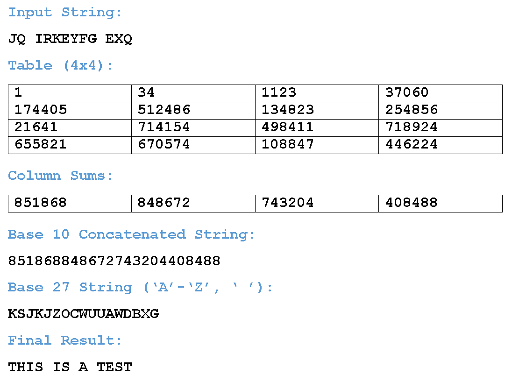

# Cheesing Python with GMP
1 November 2026

[tag]: python, competitive-programming, algorithms

It is to my surprise that Python online judges supports GMP. Well, that is if it's Pypy to be exact.

## What is GMP?

GMP stands for GNU Multiple Precision Aritmetic Library and is a library widely used to handle arbitrary-precision arithmetic on signed integers. This library is used in C++ solutions most of the time because of how it handles big numbers very well (we're talking about numbers beyond 32 and 64 bits like `int` and `long`).

## How to use GMP?

In C++, you simply include the native wrapper `<gmpxx.h>`, and then use the `mpz_class` to define the big number.

```cpp
#include <iostream>
#include <gmpxx.h>
int main() {
    mpz_class a = "123456789012345678901234567890"; 
    mpz_class b("987654321098765432109876543210");
    mpz_class sum = a+b;
    mpz_class product = a*b;
    mpz_class result = (a+5)*67; 
    std::cout << sum << " " << product << " " << result << "\n";
    return 0;
}
```

In Python, the numbers used the example above can be computed easily without using GMP, but what if we handle an even larger number, say something that has at least $10^5$ digits? This is where it gets cheesy.

Normally, you would import the `gmp` package, and the rest of the code is very similar to the above C++ code.

```python
import gmp
z = gmp.mpz(29925959575501)
for _ in range(67): z *= z
```

However, this is not a built-in library in Pypy and therefore you have to `pip-install python-gmp` first before you use it, which is not applicable in competitive programming. The same thing can be said to the `gmpy2` library.

In summary, we have to find another way to use it in online judges if we're using Pypy.

## The cheese

### The basics

Pypy actually has a shared object library (SO) that handles GMP and we can actually make use of that safely! To begin, we use the `ctypes` package to read the SO file as a `CDLL` object.

```python
from ctypes import *

g = CDLL('libgmp.so.10')
init = g.__gmpz_init
init.argtypes = [c_void_p]
init.restype = None
```

The code above loads the SO named `libgmp.so.10`. And then we use the `__gmpz_init` from the shared library as the initializer function. This mirrors the `mpz_init` function in the original GNU GMP library.

When calling C functions through `ctypes`, we need to tell Python how the function expects its arguments (`argtypes`) and what it returns (`restype`).

Since by default `ctypes` assumes that the function arguments in C are `c_int` values, we need to specify the argument types, and possibly the return types too since the default return types are also `c_int`. Here, the initializer has `argtype` equal to `[c_void_p]`, which is a list of one element: a representation of a generic pointer (not to be confused with `void` that resembles `NoneType` in most function return values). If the function needs more arguments, then just populate the list accordingly:

- `c_int` for integers `int`
- `c_uint` for unsigned integers `unsigned int`
- `c_long` for integers `long`
- `c_ulong` for unsigned integers `unsigned long`
- `c_double` for doubles `double`
- `c_char_p` for strings `char *`
- `c_void_p` for generic pointers `void *`
- `None` for `void` returns

The return type `restype`, just like `argtypes`, is by default `c_int`. So, functions with non-integer return values needs the `restype` value to be specifically declared, or otherwise treated as `c_int`. In the initializer function `init` above, I set it to `None` because the function initializes something and doesn't return anything.

Next up, we can create two other functions from the GNU GMP shared library like such. This should give a clear idea on how to specify other GMP functions in Pypy such as `mpz_set_d`, `mpz_add_ui`, `mpz_div`, and more.

```python
set_str = g.__gmpz_set_str
set_str.argtypes = [c_void_p, c_char_p, c_int]
get_str.restype = None

get_str = g.__gmpz_get_str
get_str.argtypes = [c_char_p, c_int, c_void_p]
get_str.restype = c_char_p
```

As opposed to their C counterpart's prototype...

```c
int mpz_set_str (mpz_t rop, const char *str, int base);
char* mpz_get_str (char *str, int base, const mpz_t op);
```

### The `mpz` structure

GMP represents arbitrary-precision integers using the `__mpz_struct` structure. We need to reproduce its layout in Python so that GMP can operate on the memory allocated by ctypes.

```python
class mpz(Structure):
    _fields_ = [
        ('alloc', c_int),
        ('size', c_int),
        ('d', c_void_p)
    ]
```

As shown above, there are three fields to be specified:

- `alloc`, the number of allocated limbs
- `size`, the number of limbs currently used
- `d`, a pointer to the array of limbs storing the integer's actual value

Here, a *limb* is like a GMP unit to represent large integers. That's all you need to know about the `mpz` structure in this write-up :)

Now, to use this `mpz` structure, we simply initialize by invoking `mpz()`. If we're following the clean practice, we're supposed to clear the structure using `__gmpz_clear`, but most of the time we don't need to do this since the code is going to be run once against a test case.

For the sake of this write-up, I also need to introduce to `ctypes.byref`, which gives `ctypes` a reference to the memory address of something rather than passing its value. It's really like coding C++ in Python at this point!

So, if let's say we have a `c_int` with value $42$, we can see the difference between passing by value and passing by address.

```python
a = c_int(42)
print(a.value)  # 42
print(byref(a)) # <the address of a>
```

Or maybe another example when using an `mpz` structure? How about using the `set_str` functions defined above? This is the one pattern we're going to do quite often.

```python
a = mpz()
init(byref(a)) # the initializer init from above
set_str(byref(a), b'12345678901234567890', 10) # yes, need to use `bytes` object instead, not `str`
```

### Full example

A full working example would be something like this.

```python
from ctypes import *

class mpz(Structure):
    _fields_ = [('alloc', c_int), ('size', c_int), ('d', c_void_p)]

g = CDLL('libgmp.so.10')

init = g.__gmpz_init
init.argtypes = [c_void_p]
init.restype = None

set_str = g.__gmpz_set_str
set_str.argtypes = [c_void_p, c_char_p, c_int]
set_str.restype = c_int

get_str = g.__gmpz_get_str
get_str.argtypes = [c_char_p, c_int, c_void_p]
get_str.restype = c_char_p

add = g.__gmpz_add
add.argtypes = [c_void_p, c_void_p, c_void_p]
add.restype = None

a, b, c = mpz(), mpz(), mpz()

for x in (a, b, c):
    init(byref(x))

set_str(byref(a), b'12345678901234567890', 10)
set_str(byref(b), b'98765432109876543210', 10)

add(byref(c), byref(a), byref(b)) # c = a+b

for base in (2, 8, 10, 16, 27): # output c in multiple bases
    z = get_str(None, base, byref(c))
    print(f'Base {base}: {z.decode()}')
```

> GMP supports bases from 2 to 62, just like Python's `int` conversion from strings. For bases up to 36, letters are case-insensitive, but for bases above it, both lowercase and uppercase represent different digit values.

## Alien Codebreaking

One good example from Kattis that my friend [Jeremy Lim](https://open.kattis.com/users/jeremy-lim) recommended to experiment GMP on is his own favorite problem: [Alien Codebreaking](https://open.kattis.com/problems/aliencodebreaking).

<figure style="text-align: center;">
    
    <figcaption><i>Source: Kattis, 2017 Virginia Tech High School Programming Contest</i></figcaption>
</figure>

### Problem statement

You are given $1 \le N \le 10^6$, $1 \le X \le 250000$, and a string $S$ of length $N$ containing only uppercase letters and spaces. There are a few steps to follow in order to decrypt the string $S$.

- **Step 1**: Define a function $f^1(x) = (33x+1) \pmod{2^{20}}, f^n(x) = f(f^{n-1}(x)) \forall n = 2, 3, \cdots$ and so on.
- **Step 2**: We want to populate a $X$ by $X$ grid by filling the values from left-to-right then top-to-bottom with the values $f^1(0), f^2(0), \cdots, f^{X^2}(0)$ in this specific order.
- **Step 3**: Obtain the column sums (sum of values in every column) modulo $2^{20}$.
- **Step 4**: Concatenate the base-$10$ representations of the column sums to get a very long base-$10$ number, e.g. `123450` and `12367` becomes `12345012367`. Denote this super long number as $A$.
- **Step 5**: Convert $A$ to base $27$, denote the result as $W$.
- **Step 6**: Start iterating through $S$, and for each letter $s_i$ where $i = 1, 2, \cdots, N$, shift the letter by the $i$-th digit of $W$, and then output the alphabetical version of the shifted value modulo $27$. Here, we assign $A-Z$ to $0-25$ and the SPACE to $26$.

So, using the above picture, we can trace the example as follows:

- With $X = 4$, our concatenated number $A$ is equal to `851868_848672_743204_408488` (underscores added for readability).
- Converting this to base $27$ gives us the base-$27$ number $W$, which is equal to `KSJKJZOCWUUAWDBXG`, or if we represent it as array of integers, `[10, 18, 9, 10, 9, 25, 14, 2, 22, 20, 20, 0, 22, 3, 1, 23, 6]`.
- Read per letter of $S$, `JQ IRKEYFG EXQ`, and shift accordingly:
    - `J` shifted by 10 becomes $9 + 10 = 19$, which is assigned to `T`.
    - `Q` shifted by 10 becomes $16 + 18 = 34 = 7 \pmod{27}$, which is assigned to `H`.
    - SPACE shifted by 10 becomes $26 + 9 = 35 = 8 \pmod{27}$, which is assigned to `I`.
    - `I` shifted by 10 becomes $8 + 10 = 18$, which is assigned to `S`.
    - `R` shifted by 10 becomes $17 + 9 = 26$, which is assigned to SPACE.
    - `K` shifted by 10 becomes $10 + 25 = 35 = 8 \pmod{27}$, which is assigned to `I`.
    - `E` shifted by 10 becomes $4 + 14 = 18$, which is assigned to `S`.
    - `Y` shifted by 10 becomes $24 + 2 = 26$, which is assigned to SPACE.
    - `F` shifted by 10 becomes $5 + 22 = 27 = 0 \pmod{27}$, which is assigned to `A`.
    - `G` shifted by 10 becomes $6 + 20 = 26$, which is assigned to SPACE.
    - SPACE shifted by 10 becomes $26 + 20 = 46 = 19 \pmod{27}$, which is assigned to `T`.
    - `E` shifted by 10 becomes $4 + 0 = 4$, which is assigned to `E`.
    - `X` shifted by 10 becomes $23 + 22 = 45 = 18 \pmod{27}$, which is assigned to `S`.
    - `Q` shifted by 10 becomes $16 + 3 = 19$, which is assigned to `T`.
- In the end, output `THIS IS A TEST`.

### Solution

That's indeed a problem statement, so we're going to do things step-by-step.

- Setting up the $X$-by-$X$ square grid
- Obtain the concatenated column sum $A$
- Converting $A$ to the base-$27$ version $W$
- Using $W$ to run down on $S$

#### Reading the input

Simple `input` will do for now. I'll leave the black magic I/O and `array` optimizations for later.

```python
N, X = map(int, input().split())
S = input()
```

#### The square grid

Assuming we start small and ignore the modulo $2^{20}$, we realize that there is a pattern on $f^n(0)$.

$$
\begin{align*}
f^1(0) &= 33 \cdot 0 + 1 = 1 \\
f^2(0) &= 33 \cdot 1 + 1 = 33 + 1 \\
f^3(0) &= 33 \cdot (33 + 1) + 1 = 33^2 + 33 + 1 \\
&\cdots \\
f^n(0) &= \sum_{i=0}^{n-1} 33^i = \frac{33^n-1}{32}
\end{align*}
$$

This means obtaining the column sum of the $i$-th column is equivalent to finding

$$
\begin{align*}
f^{i}(0) + f^{i+X}(0) + \cdots + f^{i+(X-1)X}(0) &= \sum_{j=0}^{X-1} \frac{33^{i+X \cdot j}-1}{32} \\
&= \frac{-X + 33^i \sum_{j=0}^{X-1} (33^X)^j}{32} \\
&= \frac{-X + 33^i \cdot \frac{(33^X)^X-1}{33^X-1}}{32}
\end{align*}
$$

Assuming $C$ stores the column sums. Then by setting $L = \frac{(33^X)^X-1}{33^X-1}$, ideally we should be able to find the value of $C_i = \frac{33^i \cdot L - X}{32} \pmod{2^{20}}$. However, the problem here is that $2^{20}$ is not a prime number, so some numbers are actually not invertible. How do we get over this?

A workaround is to compute $f^1(0), f^2(0), \cdots, f^{2^{20}}(x)$ in one pass and store them in an array $V$, as we can reuse the value of $f^{k-1}(x)$ to compute $f^k(x)$.

To compute $C_1$, we compute $\left\( \sum_{j=0}^{X-1} V[j \cdot X \pmod{2^{20}}] \right\) \pmod{2^{20}}$, since we have obtained the values of $V[i] = f^{i+1}(x)$.

Next, notice when computing $C_i$ where $i > 1$, notice that the transition from $C_{i-1}$ is as follows.

$$
\begin{align*}
C_i &= f^{i}(0) + f^{i+X}(0) + \cdots + f^{i+(X-1)X}(0) \\
&= (33f^{i-1}(0)+1) + (33f^{i-1+X}(0)+1) + \cdots + (33f^{i-1+(X-1)X}(0)+1) \\
&= 33 \left( f^{i-1}(0) + f^{i-1+X}(0) + \cdots + f^{i-1+(X-1)X}(0) \right) + X \\
&= 33C_{i-1}+X
\end{align*}
$$

This way, we are able to get all the columns modulo $2^{20}$ without having to perform any inverse modulo!

```python
M = 1<<20

# set up f^1(0), f^2(0), ...
V = [1]
for _ in range(1<<20): V.append((V[-1]*33+1)%M)

# set up C_1
C = [0]
for i in range(X): C[0] = (C[0]+V[X*i%M])%M

# populate C_2, ..., C_X
for i in range(X-1): C.append((C[-1]*33+X)%M)
```

The entire process should run in $O(2^{20})$ time, which is fast enough. A normal brute-force will take $O(X^2)$ time which is too slow since $X^2 < 6.25 \times 10^{10}$>, so the DP transition approach was necessary, **or is it**?

<details>
<summary><u><b>Click to show further optimization</b></u></summary>
<div class="boxed">

Back to our initial computation of our first-column sum $C_1$, now no longer ignoring the modulos, we have

$$
C_1 = \sum_{j=0}^{X-1} \frac{33^{1+X \cdot j}-1}{32} \pmod{2^{20}}
= \frac{33 ( \sum_{j=0}^{X-1} 33^{X \cdot j} ) - X}{32} \pmod{2^{20}}
$$

Suppose $T = \sum_{j=0}^{X-1} 33^{X \cdot j}$ without any modulo (so the value of $T$ can be very big). The value of $C_1$ is therefore simplified to $T + \frac{T-X}{32} \pmod{2^{20}}$.
<br><br>
Denote $t = T \pmod{2^{25}}$ (here, $t$ is bounded by $2^{25}-1$), then we have $T = t + q \cdot 2^{25}$ for some integer $q$. Thus,

$$
C_1 = T + \frac{T-X}{32} \pmod{2^{20}}
= t + q \cdot 2^{25} + \frac{t + q \cdot 2^{25}-X}{2^5} \pmod{2^{20}}
= t + \frac{t -X}{32} \pmod{2^{20}}
$$

It suffices to show $32$ divides $t-X$, and I can confidently divide them without using any inverse modulo. But this follows from the fact that $T = \sum_{j=0}^{X-1} 33^{X \cdot j} \equiv \sum_{j=0}^{X-1} 1^{X \cdot j} = X \pmod{32}$ and $T = t + q \cdot 2^{20} \cdot 32 \Rightarrow T \equiv t \pmod{32}$.
<br><br>
With the simplification above, we have removed the array $V$ to store all $2^{20}$ modulos upfront! So now, the next part is to compute $t$ itself. Previously, we did this in $O(X)$ time, let's try to make it run in $O(\log X)$. (but note that the joining of the digits in $C$ to $A$ will still take $O(X)$ time anyways)
<br><br>
Suppose $K = 2^{25}$, we can use the following recursive implementation to compute $t$, which is a geometric series sum.

```
def f(r, n):
    if n == 0: return 0, 1
    if n&1: s, p = f(r, n-1); return (s+p)%K, p*r%K
    s, p = f(r, n>>1); return s*(1+p)%K, p*p%K
t, _ = f(pow(33, X, K), X)
```

This is very similar to the fast exponentiaton algorithm which takes $O(\log n)$ time where $n$ is the exponent, and therefore so will be this function's time complexity: $O(\log X)$.
<br><br>
And there we have it! Some (unnecessary) optimizations for the construction of the column sums, which I won't include in the final code because it's not the main topic of the solution: GMP!
</div>
</details>

#### The concatenation

Let's assume GMP is not used first, then concatenating the $X$ modulos can be done as such.

```python
A = int(''.join(map(str, C)))
```

Since each modulo is at most $1048575$, then $A$ has at most $7X$ digits, which is at most $1.75 \times 10^6$, almost 2 million! To safeguard the execution we need to add this statement at the very beginning.

```python
import sys
sys.set_int_max_str_digits(2*10**6) # at most 1.75M digits in A
```

> This is not necessary for lower Python versions, but since the judges are using at least Python 3.11, we have to add this safeguard.

#### The base conversion

An intuitive method would be to repeatedly divide by $27$, and then display the values in reverse.

```python
W = [] # W[0] is the last digit, W[-1] is the leading digit
while A:
    W.append(A%27)
    A //= 27
```

However, this process is too slow for two reasons:

- As $W$ will contain at most about $\log_{27}{10^{1.75 \times 10^6}} = 1.75 \times 10^6 \times \log_{27}{10} \approx 1.23 \times 10^6$, which is quite much larger than $N < 10^6$.
- Repeatedly dividing large numbers by a small divisor such as $27$ will let Python use a long division on the CPython limbs that represent $A$, so the cost of the division is actually linear to the number of limbs, which when accumulated into the entire conversion process, becomes quadratic, which is bad.

A quicker way is using divide-and-conquer approach, as we will eventually divide the number by a large divisor $27^x$, causing the total number of limbs being processed to be much less: the same for every level, but there are logarithmically many levels. This will teach you two things:

- This question is a good demonstration on how multiplication isn't exactly $O(1)$ time for larger integers.
- $O(n^2)$ vs $O(n \log n)$ approach to the same problem.

As for the divide-and-conquer approach, we can pre-specify the length of $W$ to be the next power of $2$ from however many digits $W$ will actually have.

```python
# D = next power of 2
D = 1
while 27**D < A: D *= 2

# WARNING: precomputing 27**k unfortunately triggers MLE since 27**k can be very big

W = [0]*D # W[0] is the last digit, W[-1] is the leading digit
Q = [(A, 0, D-1)] # process indices [0, D-1]
Z = []
while Q:
    x, l, r = Q.pop() # process indices [l, r]
    if x < 27:
        W[l] = x
    else:
        k = r-(l+r)//2
        p, q = divmod(x, 27**k)
        Q.append((q, l, l+k-1)) # process the last k digits at indices [l, l+k-1] using the modulo
        Q.append((p, l+k, r)) # process the remaining digits at indices [l+k, r] using the quotient
while W[-1] == 0: # clean up leading digits being 0
    W.pop()
```

The runtime in this algorithm depends on the time complexity of the integer divisions, but clearly it has a "recursion" depth of $O(\log n)$, where $n$ is the number of digits of $W$ (or so approximated to $D$).

#### The input string rundown

Now that we already have $W$ in reverse order, running through $S$ is a rather simple linear iteration.

```python
for i in S:
    t = ord(i)-65
    if t < 0: t = 26 # SPACE has ASCII value 32 < 65
    t += W.pop(); t %= 27
    if t == 26: Z.append(' ')
    else: Z.append(chr(t+65))
sys.stdout.write(''.join(Z))
```

### Combining all parts

After all of that long explanation, plus some `array` optimization, we end up with this Python code.

```python
from array import *

N, X = map(int, input().split()); S = input()

V = array('I', [1]); M = 1<<20
for _ in range(M): V.append((V[-1]*33+1)%M)
C = array('I', [0])
for i in range(X): C[0] += V[X*i%M]; C[0] %= M
for _ in range(X-1): C.append((33*C[-1]+X)%M)

import sys; sys.set_int_max_str_digits(2*10**6)
A = int(''.join(map(str, C)))

D = 1
while 27**D < A: D *= 2
W = array('b', [0]*D); Q = [(A, 0, D-1)]; Z = []
while Q:
    x, l, r = Q.pop()
    if x < 27: W[l] = x
    else: k = r-(l+r)//2; p, q = divmod(x, 27**k); Q.append((q, l, l+k-1)); Q.append((p, l+k, r))
while W[-1] == 0: W.pop()

for i in S:
    t = ord(i)-65
    if t < 0: t = 26
    t += W.pop(); t %= 27
    if t == 26: Z.append(' ')
    else: Z.append(chr(t+65))

sys.stdout.write(''.join(Z))
```

**SUBMIT THIS SAME CODE AT YOUR OWN RISK OF PLAGIARISM**, but this gives you about 3.23s runtime, which is very fast for Python submissions considering the generous 13s time limit. However, we can do much better using GMP!

### The GMP in action

So, where does GMP come in handy? The conversion of $A$ to $W$!

Using the GMP tricks we saw above, we can initialize the necessary functions first.

```python
from ctypes import *

class mpz(Structure):
    _fields_ = [('alloc', c_int), ('size', c_int), ('d', c_void_p)]

g = CDLL('libgmp.so.10')

init = g.__gmpz_init
init.argtypes = [c_void_p]
init.restype = None

set_str = g.__gmpz_set_str
set_str.argtypes = [c_void_p, c_char_p, c_int]
set_str.restype = c_int

get_str = g.__gmpz_get_str
get_str.argtypes = [c_char_p, c_int, c_void_p]
get_str.restype = c_char_p
```

Then, using the same column sum array $C$, we initialize $A$ as an `mpz` structure.

```python
# suppose you have already computed C

A = mpz()
init(byref(A))
set_str(byref(A), ''.join(map(str, C)).encode(), 10)
```

We still have to convert $C$ from a list of integers, to a long string, but now $A$ is an `mpz` structure instead of a very long integer.

Converting $A$ to $W$ is simple...

```python
W = get_str(None, 27, byref(A))
```

... but we still have to handle the final translation nicely! Now, $W$ is represented as an encoded byte-string of length possibly much larger than $N$, so we have to slice only the first $N$ characters, and then translate into numbers to simulate the shifts accordingly.

```python
S = int.from_bytes(S.translate(bytes([c-65 if 65<=c<91 else 26 for c in range(256)])), 'big')
W = int.from_bytes(W[:N].translate(bytes([c-48 if 48<=c<58 else c-87 if 97<=c<114 else 0 for c in range(256)])), 'big')
print((S+W).to_bytes(N, 'big').translate(bytes([32 if v%27==26 else 65+v%27 for v in range(256)])).decode())
```

For $S$, we can translate the usual $A-Z$ from $0-25$, then $26$ from SPACE. For $W$, it is slightly different because the digits used to represent $0-26$ are different: you start from $0-9$ then $A-Q$. Finally, we can add both $S$ and $W$ and then translate it back to the alphabets $0-25$ to $A-Z$ and $26$ to SPACE. Since the final result is still a byte-string, we have to finish it off with `.decode()`.

Alternatively, we can just stick to the old implementation of going letter per letter, but this is slightly slower from what I've tried.

```python
Z = []
for i, w in zip(S, W):
    # translate w accordingly
    if w < 58: w -= 48
    else: w -= 87

    t = ord(i)-65
    if t < 0: t = 26
    t += w; t %= 27
    if t == 26: Z.append(' ')
    else: Z.append(chr(t+65))

sys.stdout.write(''.join(Z))
```

Overall, the combined code should look like this. Again, **PLAGIARIZE AT YOUR OWN RISK**.

```python
from ctypes import *

class mpz(Structure):
    _fields_ = [('alloc', c_int), ('size', c_int), ('d', c_void_p)]

g = CDLL('libgmp.so.10')

init = g.__gmpz_init
init.argtypes = [c_void_p]
init.restype = None

set_str = g.__gmpz_set_str
set_str.argtypes = [c_void_p, c_char_p, c_int]
set_str.restype = c_int

get_str = g.__gmpz_get_str
get_str.argtypes = [c_char_p, c_int, c_void_p]
get_str.restype = c_char_p

N, X = map(int, input().split()); S = input().encode()

from array import *
V = array('I', [1]); M = 1<<20
for _ in range(M): V.append((V[-1]*33+1)%M)
C = array('I', [0])
for i in range(X): C[0] += V[X*i%M]; C[0] %= M
for _ in range(X-1): C.append((33*C[-1]+X)%M)

A = mpz()
init(byref(A))
set_str(byref(A), ''.join(map(str, C)).encode(), 10)

S = int.from_bytes(S.translate(bytes([c-65 if 65<=c<91 else 26 for c in range(256)])), 'big')
W = int.from_bytes(get_str(None, 27, byref(A))[:N].translate(bytes([c-48 if 48<=c<58 else c-87 if 97<=c<114 else 0 for c in range(256)])), 'big')
print((S+W).to_bytes(N, 'big').translate(bytes([32 if v%27==26 else 65+v%27 for v in range(256)])).decode())
```

A blazing runtime of 0.5s!

Now, what other questions do you think can be heavily optimized with GMP?